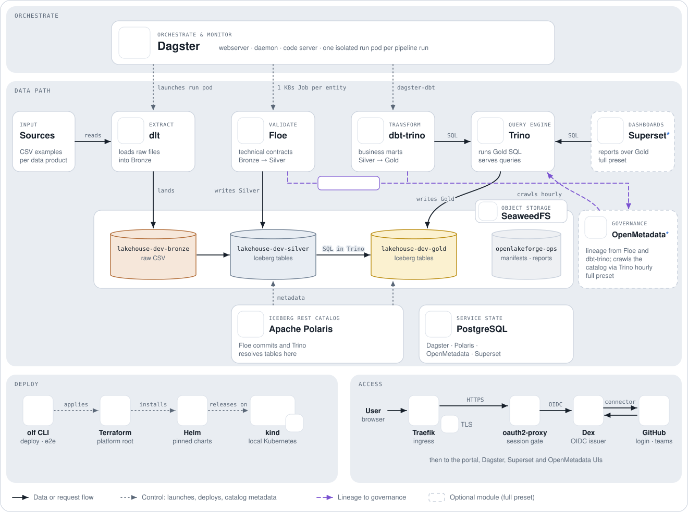

# OpenLakeForge

**An open-source lakehouse platform for small data teams — self-hosted, modular, and designed to run anywhere.**

[](https://github.com/OpenLakeForge/openlakeforge/releases)  
[](/LICENSE)  
[](/docs/release/releasing.md#lifecycle-stages)

Building a modern data platform usually means assembling and operating
ingestion, orchestration, storage, catalog, governance and analytics tools.
**OpenLakeForge packages those pieces into one opinionated, open-source
lakehouse**, so small data teams can focus on data products instead of
becoming platform engineers. Run only the core data path, add governance and
dashboards when you need them, and keep the same architecture locally, on AWS
or on Azure.

<picture>
  <source media="(prefers-color-scheme: dark)" srcset="docs/assets/architecture-local-dark.svg">
  
</picture>

> Looking for the implementation details? See the
> [architecture documentation](/docs/architecture/README.md) and the
> [technical diagrams](/docs/architecture/diagrams/README.md).

## Why OpenLakeForge?

- 🪶 **Built for small data teams** — less operational work to run a modern lakehouse.
- 🧩 **Modular** — use the core data platform alone, or add governance and analytics.
- 🔓 **Open and self-hosted** — your infrastructure, your storage, your data.
- ☁️ **Deploy anywhere** — local Kubernetes, AWS and Azure share the same platform contracts.
- 🧊 **Open table format** — Apache Iceberg keeps storage independent from the engines that use it.
- 🏗️ **Infrastructure included** — Kubernetes, Terraform and Helm come with the platform.

## How it works

Data moves through three medallion layers, each owned by one tool:

|Layer|What happens|Technology|
|---|---|---|
|**Bronze**|Source files land as CSV in object storage|dlt|
|**Silver**|Technical contracts validate them into Iceberg tables|Floe|
|**Gold**|Business marts are modelled in SQL and run in the query engine|dbt-trino on Trino|

Dagster orchestrates every run. Around that path sit the shared services:

|Capability|Technology|
|---|---|
|Table format|Apache Iceberg|
|Data catalog|Apache Polaris / AWS Glue|
|Object storage|S3-compatible storage (SeaweedFS) / AWS S3|
|Service state|PostgreSQL / Amazon RDS|
|Governance and lineage|OpenMetadata _(optional)_|
|Dashboards|Superset _(optional)_|

Infrastructure sits behind provider-neutral contracts, so local, AWS and Azure
expose the same platform capabilities with different implementations.
→ [How provider portability works](/docs/architecture/provider-contracts.md)

### Is it a good fit?

|Good fit|Not yet|
|---|---|
|A small team that wants a working batch lakehouse without building the platform first|Streaming workloads: v1 is batch-first|
|Keeping data on your own Kubernetes, storage and cloud account|Production-critical use: the project is alpha|
|Moving the same project between a laptop, AWS and Azure|Teams that want a fully managed SaaS|

## Quickstart

Deploy a local, single-stage Slim platform on Kubernetes in Docker. You need
**Docker** and **[uv](https://docs.astral.sh/uv/)**; `olf` provisions its own
pinned Terraform, Helm, kubectl and kind.

```bash
uv tool install "openlakeforge==0.4.0a1" --python 3.12

mkdir my-lakehouse && cd my-lakehouse
olf init                      # writes openlakeforge.yaml and lakehouse_code/
olf deploy --provider local   # builds the kind cluster and the whole platform
```

Then open the portal at `http://olf.localhost`, run an example data product in
Dagster and check it end to end: the
[Quickstart](docs/get-started/quickstart.md) walks through each step. New to
the vocabulary? Read the [Introduction](docs/get-started/introduction.md) and
[Concepts](docs/get-started/concepts.md).

### Your project

`olf init` creates a writable project. The platform itself (Terraform, Helm,
images) stays in the installed distribution, so your repository holds only
what you own:

```text
my-lakehouse/
├── openlakeforge.yaml      # Deployment Profile: provider, stages, preset
└── lakehouse_code/
    ├── lakehouse.yaml      # domains and data products
    ├── bronze/             # sources and their dlt loaders
    ├── silver/             # Floe contracts per domain
    ├── gold/               # dbt projects per product
    ├── pipelines/dagster/  # one Dagster job per product
    └── dashboards/superset/
```

Add your own with `olf source new` and `olf product new`, or follow
[Build your first data product](/docs/getting-started/first-data-product.md).

### Slim or Full?

|Preset|Includes|Use it when|
|---|---|---|
|**Slim** _(default)_|Ingestion, validation, Iceberg, catalog, Trino, dbt and Dagster|You want the shortest path to a working lakehouse|
|**Full**|Slim + OpenMetadata + Superset|You also want governance, lineage and dashboards|

Set `preset: full` in `openlakeforge.yaml` and run `olf deploy --provider local`
again. The optional layers do not change the ingestion-to-Gold data path.

## Stages: from a commit to PROD

<picture>
  <source media="(prefers-color-scheme: dark)" srcset="docs/assets/stage-promotion-dark.svg">
  
</picture>

A Deployment Profile can enable `dev`, an optional `uat`, and `prod`
(`olf init --stages dev,prod`). Every stage runs in the same cluster, in its
own `olf-<stage>` namespace with its own Dagster (and Superset with the full
preset), buckets and `lakehouse_<stage>` catalog. The platform services in
`olf-system` are shared.

A change is built **once** into an immutable project revision: the project's
code plus one image pinned by digest, pushed to a registry such as GHCR (ECR on
AWS). That revision is activated in DEV, validated, and then activated
unchanged in PROD.
PROD never rebuilds, and no data is copied between stages.

```bash
olf platform apply -f openlakeforge.yaml          # namespaces, buckets, catalogs per stage
olf project image  -f openlakeforge.yaml          # -> <repository>@sha256:<digest>
olf project build  --project . --image <repository>@sha256:<digest>
olf project deploy -f openlakeforge.yaml --stage dev  --revision sha256:<rev>
olf project deploy -f openlakeforge.yaml --stage prod --revision sha256:<rev>
```

`olf project image` pushes to a registry you must be able to write to: locally,
set `PROJECT_CODE_IMAGE_REPOSITORY` (for example your own GHCR repository) and
log in to it first; cloud providers use their own ECR or ACR.

In CI, the `build-revision` and `deploy-stage` GitHub Actions run these steps.
The PROD approval is yours to configure: protect the `prod` GitHub environment
with required reviewers before the first run. See
[Reference CI/CD](/docs/reference/ci-cd.md) and
[Project revisions](/docs/architecture/project-revisions.md).

## Deploy to the cloud

The same platform runs on managed infrastructure:

- ☁️ **AWS** — EKS, ECR, S3, RDS PostgreSQL and Glue:
  [AWS deployment](/docs/setup/aws.md) ·
  [AWS architecture](/docs/architecture/aws-eks-poc.md)
- ☁️ **Azure** — AKS and ACR with the in-cluster platform services:
  [Azure deployment](/docs/setup/azure.md)

## Documentation

- 🚀 [Local installation guide](/docs/setup/local.md)
- 🧱 [Build your first data product](/docs/getting-started/first-data-product.md)
- 📚 [Full documentation](/docs/README.md)
- 🏗️ [Architecture overview](/docs/architecture/overview.md) ·
  📊 [Architecture diagrams](/docs/architecture/diagrams/README.md) ·
  🔌 [Provider contracts](/docs/architecture/provider-contracts.md)
- 🧠 [Architecture Decision Records](/docs/adr/README.md)
- 📦 [Release compatibility](/docs/reference/compatibility-matrix.md) ·
  📝 [Changelog](/CHANGELOG.md) ·
  🗺️ [Roadmap](https://github.com/OpenLakeForge/openlakeforge/milestones)

## Project status

OpenLakeForge is **alpha** and under active development. Local, AWS and Azure
exercise the same platform; their validation and support maturity differ.
Follow the [milestones](https://github.com/OpenLakeForge/openlakeforge/milestones)
for the current direction.

## Contributing

Contributions, experiments and feedback are welcome. [AGENTS.md](/AGENTS.md)
contains the repository map, architectural rules, development workflow and
validation gates.

## License

OpenLakeForge is released under the [Apache License 2.0](/LICENSE).
