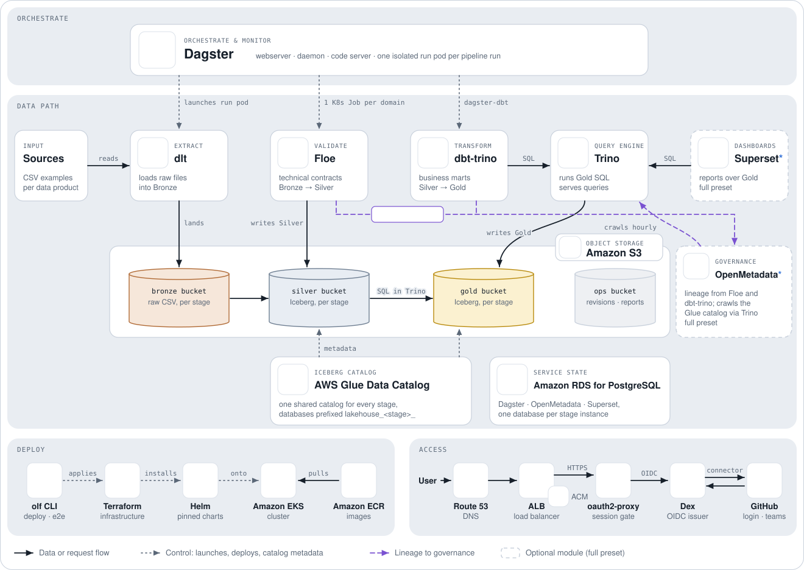

# AWS EKS Managed Services POC

The AWS POC keeps the OpenLakeForge application shape from local and Azure, but
uses managed AWS services for the lakehouse dependencies that matter most for
operations cost and durability.

<picture>
  <source media="(prefers-color-scheme: dark)" srcset="../assets/architecture-aws-dark.svg">
  
</picture>

The chart shows the target AWS shape. The access path (Route 53, ALB, ACM,
oauth2-proxy and Dex) is not built yet; [POC Limits](#poc-limits) lists what
the POC still does differently.

## Target Shape

| Boundary | AWS POC implementation |
| --- | --- |
| Cluster foundation | EKS, AWS VPC CNI, two public subnets, managed node group |
| Runtime images | ECR repository for project-code; Superset is pulled by its pinned digest |
| Object storage | S3 buckets for Bronze, Silver, Gold, and ops artifacts |
| Metadata database | RDS PostgreSQL for Dagster, OpenMetadata, and Superset |
| Iceberg catalog | AWS Glue Data Catalog |
| Query path | Superset -> Trino -> Glue/S3 |
| Orchestration | Dagster Helm release with per-domain code locations |
| Artifacts | Project revisions, Floe reports, logs, and run artifacts in the S3 ops bucket |
| Identity | EKS Pod Identity associations for lakehouse workloads (see ADR 0010) |
| Access | `kubectl port-forward`, matching the other POCs |

Trino remains the implemented query engine. Athena is deferred because it would
change query pricing, Superset configuration, validation behavior, and the cost
model from always-on compute to pay-per-data-scanned queries.

## Terraform Roots

`infra/terraform/foundations/aws-eks` creates:

- VPC, internet gateway, route table, and two public subnets.
- EKS control plane and managed node group.
- EKS VPC CNI, CoreDNS, kube-proxy, EBS CSI, and Pod Identity agent add-ons.
- An ECR repository for project-code.
- An EKS Pod Identity role/association for the EBS CSI driver (see ADR 0010).

`infra/terraform/environments/aws-poc` consumes the foundation state and creates:

- S3 medallion and ops buckets.
- Product-layer Glue databases for every Silver and Gold layer. The AWS Glue
  catalog is the AWS account/catalog ID; `lakehouse_dev` remains the SQL catalog
  alias used by engines, not a Glue database.
- RDS PostgreSQL plus Kubernetes Secrets for application database users.
- A Pod Identity role/policy and per-service-account associations for S3 and Glue access.
- Trino, Dagster, Superset, and OpenMetadata through the shared Helm modules.

## Contracts

The AWS root exports the same `provider_contracts` output as local and Azure.
The active AWS contract implementations are:

- `foundation.eks`
- `platform.kubernetes.eks`
- `storage.aws_s3`
- `metadata_database.aws_rds_postgresql`
- `catalog.aws_glue`
- `artifacts.aws_ecr_and_s3`
- `identity.aws_pod_identity`

The Glue catalog contract uses `catalog_type = "glue"` and
`catalog_provider = "aws-glue"`. Consumers branch on those fields:

- Trino uses its Glue catalog configuration.
- Dagster passes AWS/Glue runtime environment to runs and code locations.
- Floe keeps medallion S3 storage aliases in the Floe configs, then renders a
  schema-valid native Glue profile (`type: "glue"`) per product. The profile
  uses the product Silver layer as the Glue database, so writes resolve as
  `lakehouse_dev.<product_layer_database>.<table>` in SQL engines.
- dbt-trino uses the same profile as every provider
  (`libs/dbt/profiles/trino.yml`). Its Gold schema carries the stage prefix
  from `OPENLAKEFORGE_CATALOG_SCHEMA_PREFIX`, and it reaches the Glue Iceberg
  catalog through Trino, so transformation pods carry no direct catalog
  credentials.
- OpenMetadata registers the lakehouse through Trino (service `aws_glue`), as on
  every provider.

## Workflow

Static checks:

```sh
olf check structure
olf check contracts
olf check infra
```

AWS POC lifecycle:

```sh
olf deploy --provider aws --phase foundation
olf deploy --provider aws
olf forward --provider aws
olf e2e run --env aws
olf destroy --provider aws
```

`olf deploy --provider aws` runs the foundation, platform, and artifacts phases
in order. The artifact phase reconciles catalog namespaces, builds and pushes
project-code to ECR, imports Superset report assets, deploys OpenMetadata
metadata, patches Dagster runtime images, and restarts Dagster workloads.

Use `olf destroy --provider aws --phase platform` followed by
`olf destroy --provider aws --phase foundation` only when you want to tear down
the two Terraform roots manually; `olf destroy --provider aws` wraps both in
that order.

## Compatibility Gate

The AWS full-suite compatibility gate proves:

- one Silver write through Floe into Glue/S3;
- one Gold write through dbt-trino into Glue/S3;
- Trino can query both layers through Glue;
- OpenMetadata can seed and crawl Glue-backed namespaces.

`olf e2e run --env aws` first checks cluster health, provider contracts, S3,
Glue, Trino, and core workloads, then launches all Dagster product jobs and
validates tables, marts, dashboards, metadata, and runtime artifacts. Use
`olf e2e run --env aws --suite smoke` to run only the preflight checks.

## POC Limits

The v1 AWS POC deliberately keeps local Terraform state, port-forward access,
Kubernetes Secrets, no ingress/TLS, no remote state, no Secrets Manager, and no
Lake Formation. Those belong behind later production-hardening contracts.
