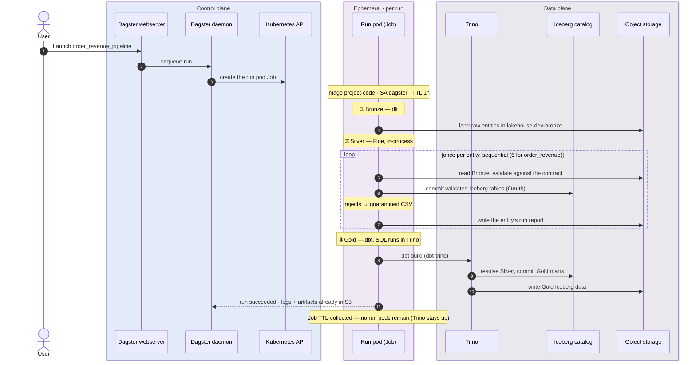
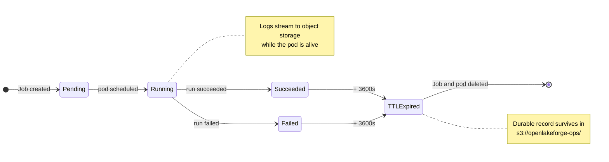

# Chart 3 — Ephemeral Kubernetes Job Lifecycle

**Orchestration and ingestion run in an ephemeral pod, not a long-lived one.** Clicking
*Launch* on a Dagster job creates one ephemeral Kubernetes Job for the run pod, from the
code location's own project-code image. That pod does the Bronze and Silver work itself:
dlt lands Bronze, then Floe — installed in the same image — validates each entity
in-process, one after another. A product with six Silver inputs (e.g. `order_revenue`)
validates six entities over one pipeline run, never concurrently. The run pod is
garbage-collected on TTL, so between runs no run pod remains.

Gold is the deliberate exception: dbt does **not** do its work in the pod — `dbt-trino`
pushes the SQL into the **long-lived Trino service**, where the transformation compute
and its resource contention live (chart 2). So Bronze (dlt) and Silver (Floe) are sized
by the run pod, while Gold work is sized at the shared Trino coordinator. The per-run
footprint — everything except the standing platform services — returns to zero between
runs.

## The run



The exact values live in the Terraform module and the stage's rendered Floe profile: the
run pod uses `ttlSecondsAfterFinished: 3600` and ServiceAccount `dagster`, carries the
contract-derived environment variables plus `envFrom` secrets, and runs each product job
with `max_concurrent: 1` because the profile's Floe orchestration is `sequential`.

## Where each engine does its work

| | Floe (Silver) | dbt (Gold) |
| --- | --- | --- |
| Orchestrated from | The run pod | The run pod |
| Executes in | **The run pod**, in-process | **Trino** — dbt-trino pushes the SQL down |
| Version | `floe-python`, pinned in `project-code` | `dbt-trino`, pinned in `project-code`; Trino via Helm |
| Upgrade path | Bump `floe-python` and `dagster-floe`; rebuild `project-code` | Bump dbt in `project-code`; Trino via Helm |
| Storage access | S3 directly + catalog commits | Trino reads/writes S3; the run pod touches no data |
| Credentials | `polaris-floe-creds`, mounted on the run pod | none — dbt reaches the catalog through Trino, which holds `polaris-trino-creds` (the bootstrap deletes the old `polaris-dbt-creds`) |

Floe holds an entity's frames in the run pod's memory while it validates them, so the
run pod is what bounds Silver; dbt is a thin client whose transformations execute inside
Trino — the run pod never holds Gold data in memory (PR #62 replaced the earlier DuckDB
materialization).

## Job lifecycle

`ttlSecondsAfterFinished` keeps completed Jobs from accumulating: Kubernetes deletes the
Job and its pod an hour after it reaches a terminal state, leaving the logs and reports
already written to object storage as the durable record.



## Observing it live

```sh
kubectl --context kind-openlakeforge-local -n olf-dev get jobs -w
```

A `dagster-run-<id>` Job appears for the run and disappears an hour after completion; no
other Job is created for Silver.

## Source of truth

- [libs/product_dagster.py](../../../libs/product_dagster.py) — asset graph assembly from the Floe project
- [libs/floe_profile.py](../../../libs/floe_profile.py) — the stage's Floe profile: storages, catalog, lineage, sequential orchestration
- [lakehouse_code/silver/floe.yml](../../../lakehouse_code/silver/floe.yml) — the Floe project
- [infra/terraform/modules/orchestration/dagster/main.tf](../../../infra/terraform/modules/orchestration/dagster/main.tf) — `K8sRunLauncher`, `ttlSecondsAfterFinished`, runtime env
- [libs/dbt/profiles/](../../../libs/dbt/profiles/) — dbt targets (`type: trino` since PR #62)
- [ADR 0006](../../adr/0006-dagster-runtime-and-code-locations.md), [ADR 0001](../../adr/0001-platform-baseline-and-component-stack.md)
