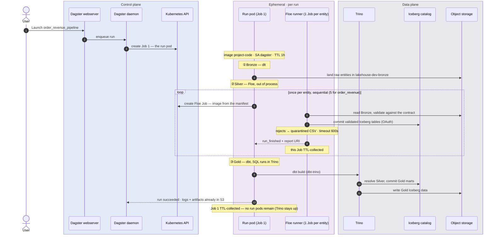
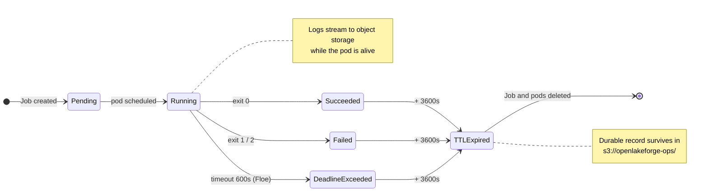

# Chart 3 — Ephemeral Kubernetes Job Lifecycle

**Orchestration and ingestion run in ephemeral pods, not long-lived ones.** Clicking
*Launch* on a Dagster job creates an ephemeral Kubernetes Job for the run pod, and that
pod *itself* creates **one ephemeral Floe Job per entity** — sequentially, from a
container image declared inside the Floe manifest rather than in the Dagster deployment.
A product with five entities (e.g. `order_revenue`) runs five distinct Floe Jobs over one
pipeline run, never concurrently. All of them are garbage-collected on TTL, so between
runs no run pod or Floe Job remains.

Gold is the deliberate exception: dbt does **not** spawn a pod — `dbt-trino` pushes the
SQL into the **long-lived Trino service**, where the transformation compute and its
resource contention live (chart 2). So Bronze (dlt) and Silver (Floe) get per-run pods
with per-run limits, while Gold work is sized at the shared Trino coordinator. The
upshots: the ingestion engine upgrades without rebuilding the orchestrator image, a
failing entity cannot poison a shared worker, and the per-run footprint — everything
except the standing platform services — returns to zero between runs.

## The run



The exact values live in the manifest and the Terraform module: the run pod and every
per-entity Floe Job use `ttlSecondsAfterFinished: 3600` and ServiceAccount `dagster`; the
Floe runner is `ghcr.io/malon64/floe:0.6.11` with `timeout_seconds: 600`, polled every
5s; exit codes are
`0 = success_or_rejected`, `1 = technical_failure`, `2 = aborted`; and the run pod
carries the ~40 contract-derived environment variables plus `envFrom` secrets.

## Where each engine does its work

| | Floe (Silver) | dbt (Gold) |
| --- | --- | --- |
| Orchestrated from | The run pod | The run pod |
| Executes in | **Its own Kubernetes Job** | **Trino** — dbt-trino pushes the SQL down |
| Image | `ghcr.io/malon64/floe:0.6.11` — declared in the manifest | `project-code` runs the dbt CLI |
| Upgrade path | Regenerate the manifest; no image rebuild | Bump dbt in `project-code`; Trino via Helm |
| Storage access | S3 directly + catalog commits | Trino reads/writes S3; the run pod touches no data |
| Credentials | `polaris-floe-creds` | none — dbt reaches the catalog through Trino, which holds `polaris-trino-creds` (the bootstrap deletes the old `polaris-dbt-creds`) |

Floe brings its own runtime image and is invoked through a declared contract; dbt is a
thin client in the run pod whose transformations execute inside Trino — the run pod
never holds Gold data in memory (PR #62 replaced the earlier DuckDB materialization).

## Job lifecycle

`ttlSecondsAfterFinished` keeps completed Jobs from accumulating: Kubernetes deletes the
Job and its pods an hour after they reach a terminal state, leaving the logs and reports
already written to object storage as the durable record.



## Observing it live

```sh
kubectl --context kind-openlakeforge-local -n olf-dev get jobs -w
```

A `dagster-run-<id>` Job appears first, then one Floe runner Job per entity while the
run pod is still `Running`, then all of them disappear an hour after completion.

## Source of truth

- [libs/product_dagster.py](../../../libs/product_dagster.py) — asset graph assembly, Floe manifest resolution
- [lakehouse_code/silver/sales/contracts/floe/manifests/sales.manifest.json](../../../lakehouse_code/silver/sales/contracts/floe/manifests/sales.manifest.json) — runner spec (image, TTL, timeout, secrets), exit-code contract
- [infra/terraform/modules/orchestration/dagster/main.tf](../../../infra/terraform/modules/orchestration/dagster/main.tf) — `K8sRunLauncher`, `ttlSecondsAfterFinished`, runtime env
- [libs/dbt/profiles/](../../../libs/dbt/profiles/) — dbt targets (`type: trino` since PR #62)
- [ADR 0006](../../adr/0006-dagster-runtime-and-code-locations.md), [ADR 0006](../../adr/0006-dagster-runtime-and-code-locations.md), [ADR 0001](../../adr/0001-platform-baseline-and-component-stack.md)
