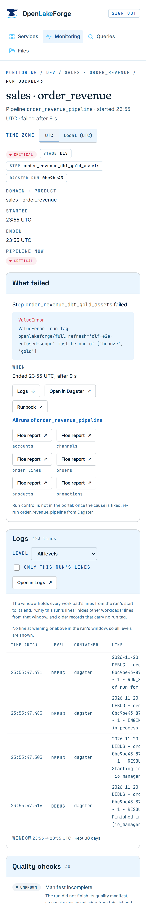

# Walk through a failed run

Follow one failed pipeline run from the Portal's overview to its logs, its quality report and the fix, without
Kubernetes, Prometheus, Loki or Grafana. It is the v0.7 operator journey (#794): *overview → degraded stage → failed
run → logs → quality report → recovery*. Every step also gives the command line or API read that shows the same
thing.

Each step names the e2e check that proves it on every full run, so the walkthrough can be repeated on a fresh cluster.

The screenshots are from the e2e "operator journey screenshots" drill on a local deployment with the example data
(artifact `walkthrough-screenshots-<run id>`).

## Before you start

You need a local deployment with DEV, the Portal and the log archive. Metrics are optional, and step 6 shows both
cases. Starting from `olf init`:

```yaml
spec:
  preset: full          # Slim works too: steps 1 to 5 need no Full service
  stages:
    dev:
      enabled: true
  access:
    tls: none
  observability:
    metrics:
      enabled: true     # optional, for step 6
```

```bash
olf infra deploy
```

Load the example data once, so Bronze holds files for Silver to rebuild from. A fresh deployment registers the jobs
but runs none, and DEV has no schedules:

```bash
olf infra product run <product> --stage dev
```

It waits for the run and should end in success. Then make a failed run that has written its quality checks, in Dagster
(`http://dagster-dev.olf.localhost`): open a product's job, select its Silver and Gold assets only, and in the
launchpad add two run tags:

| Tag | Value |
| --- | --- |
| `openlakeforge/full_refresh` | `not-a-scope` |
| `floe/full_refresh` | `true` |

Floe rebuilds the job's Silver tables from Bronze and records its checks. The dbt step then refuses the unknown
full-refresh scope ([full refresh](../../reference/descriptors.md#full-refresh)), so the run fails before Gold
changes. Leave out the Bronze assets: their step reads the same tag and would fail the run before Floe.

The run's pods are deleted an hour after it ends; the steps below work before and after that, since the logs and
reports are read from the archive and the ops bucket. The full e2e suite makes the same run on a deployment with
the e2e sign-in stub (its `failed run drill-down through the platform API` check), and deletes the pods at once.

Open the Portal at `http://olf.localhost`. With sign-in off, the Portal and the API serve you as `platform-admin`.
With sign-in on, a `data-engineer` sees all of this on DEV, and needs a higher role for PROD's logs and reports
([roles](../../reference/roles-and-permissions.md)).

Alert incidents and notifications (steps 1, 2 and 5) exist only when the profile declares a receiver: see
[Configure a receiver](alerts.md#configure-a-receiver). Without one, the alert evaluator does not run, the Portal
shows alerts as not provided, and everything else in this walkthrough is the same.

## 1. See that something needs attention

Open **Monitoring**, then select the stage. The overview shows the stage's state, its services, the pipelines and
data quality. **What needs attention** is one list of the stage's failing signals and open alert incidents, worst
first, each once, with whether its notification went out. A failed run makes its pipeline `critical`, and the run
appears in that list with a link to it.

Times on the Monitoring pages are in UTC until you pick **Local** in the **Time zone** switch; the browser keeps the
choice across pages and reloads.

Nothing is shown as healthy that the platform did not answer for: a service, a pipeline or a quality source that
cannot be read is `unknown`, with the reason.


The same answers on the command line:

```bash
olf health dev
olf pipelines health dev
```

Proven by: the alert drill (`alert notifications reach a receiver`) for the failed-run, missed-run and quality
states, and the walkthrough drill's first page.

## 2. Open the failed run

Follow the run link. The **Failed-run** screen shows the run's domain and product, its start and end, and the
pipeline's state now, then:

- **What failed**, first: the failed step and the first line of its error, when the run ended, and where to look next:
  the run's logs on this page, **Open in Dagster**, the **Runbook** for the condition, **All runs of** the job, and
  the run's retained quality reports (step 4). Run control stays in Dagster: once the cause is fixed, re-run the job
  there (step 5);
- **Logs** (step 3);
- **Quality checks** (step 4);
- **Data quality**: rows rejected and accepted, and the Floe and dbt outcome counts, from the run's quality manifest;
- **Open incidents** for this pipeline, and whether their notification was delivered.

<!-- Screenshot 02-failed-run.png (the Failed-run screen at desktop width) to replace from the next full e2e run: the
     capture in run 44828390545 was taken while the Logs card still read "Reading the run's archived lines…". -->

At phone width the same screen stacks its cards, **What failed** first:



**Monitoring → Runs** lists the stage's runs of the last 24 hours, newest first, and filters them by pipeline,
product, status and window (1 hour to 7 days); each row opens its run. On the overview, a pipeline's name links to its
runs, and its failed-run count to those failed runs.


```bash
olf runs show <run-id> --stage dev
```

The API read is `GET /api/v1/stages/dev/runs/<run-id>/failure`.

## 3. Read the run's logs

The **Logs** card reads the run's own window from the log archive, even though the run's pods are deleted. A run that
crosses midnight is read across both days. Each line shows its time and level when the source recorded them, and
leaves them empty otherwise. The card opens at warning and above, or at all levels when the window holds no such
line; **Level** and **Show all levels** change it. **Only this run's lines** drops other workloads' lines from the
same window, and **Load more** pages on. The footer gives the window read and how long the archive keeps logs
(**Kept N days**). **Open in Logs ↗** opens the same window on the **Logs** page (`Monitoring → Logs`), which also
browses the stage's archive by day and hour, with level, pod and search filters.


The API read is `GET /api/v1/stages/dev/runs/<run-id>/logs?match_run=true`. It covers the run's whole window, across
UTC days. A cut-off answer carries `next`; pass it back as `after` for the next page.

`olf logs` reads one UTC day at a time, today by default. For a run from another day, give its date, and repeat
the read for each day a run crosses:

```bash
olf logs --stage dev --run-id <run-id> --date <YYYY-MM-DD> --severity error
```

`--run-id` selects lines but still reads the whole day, and the platform API stops a log read after 20 seconds. On a
busy stage, add `--since` and `--until` around the run's start and end so only those hours are read.

How the archive works, and what to do when delivery stops, is in
[Log archive](log-archive.md).

Proven by: `short-lived pod output in the log archive`, `log collector restart mid-stream` and the failed-run
drill-down, which pages the whole window through the API after the pods are gone.

## 4. Read the quality report

The **Quality checks** card lists the run's Floe and dbt checks from its quality manifest that did not pass, errors
first; the passes are behind their count (**N passed**), one click away. Each row shows the outcome (`ERROR`, `WARN`,
`PASS`, `NOT RUN` or `UNKNOWN`), the check, the table and column, the engine's severity, what the pipeline did with it
(quarantined rows, blocked the run, continued), and the counts the engine recorded. A run with no manifest, or an
unfinished one, says so; it never shows passes it did not record.


**Floe report ↗** and **dbt results ↗**, under **What failed**, download the retained reports through the API, as
JSON attachments. The browser never gets an object-store address. A role that may not read the stage's reports sees
the report named without a link.

The API reads are `GET /api/v1/stages/dev/runs/<run-id>/quality` and the `href` of each entry in its `reports`.

With governance on (Full), the same results are OpenMetadata test cases on the stage's tables, published by the
stage's quality-writer bot. The run's results appear there after the next reconciler pass.

Proven by: `real run quality evidence` (Floe, dbt and OpenMetadata, in DEV and PROD), `OpenMetadata quality
publication`, and the failed-run drill-down's quality and report reads.

## 5. Fix it and confirm the recovery

The run's quality answer, every alert incident and every alert notification link to the runbook section for its
condition: [a failed run](alerts.md#run_failed) or [a failed quality check](alerts.md#quality). Each section gives what
to check in the Portal, then on the command line, the common causes and the recovery.

Once the cause is fixed, run the job again: from Dagster, or as yourself on DEV:

```bash
olf runs launch <job> --stage dev
```

When the run succeeds, the pipeline returns to `healthy` on the overview and in `olf pipelines health dev`, and the
alert incident, if a receiver is configured, resolves and the receiver gets the resolution.

Proven by: the alert drill, which raises a Floe warning, escalates it to an error, resolves it on a passing run, and
checks the notification's runbook link.

## 6. Look at resource history

With `metrics.enabled: true`, **Monitoring → Metrics** charts the stage's CPU, memory and storage per component, Trino
load and errors, pipeline runs and duration, and the cluster's nodes, over the last 1 h, 6 h, 24 h or 7 d. Each chart
has a text summary and a table view.

When Prometheus is down, each chart says the history is unknown and offers Retry; nothing is drawn as zero. With
metrics off, as on Slim, the page says resource history is not collected, and the pipeline charts, which come from
Dagster, still show.

<!-- Screenshot 07-metrics.png to replace from the next full e2e run: the capture in run 44828390545 was taken while
     several charts still read "Reading …". -->

Proven by: `metrics series through the platform API`, `metrics outage reads unavailable` and `metrics labels and series
budget`.

## What #794 asks, and where it is proven

| #794 scenario | Step | e2e check |
| --- | --- | --- |
| 1. Slim, no monitoring stack | 1 to 5 | The Slim smoke on every pull request; no Prometheus or kube-state-metrics on Slim (`wiring.tftest.hcl`) |
| 2. Short-lived failed job, logs and report after its pods are gone | 2 to 4 | `short-lived pod output in the log archive`, `log collector restart mid-stream`, failed-run drill-down |
| 3. Quality WARN and ERROR in Dagster, the Portal, the report and OpenMetadata | 4 | `real run quality evidence`, `OpenMetadata quality publication`, the alert drill |
| 4. Optional metrics, and an outage shown as unknown | 6 | `metrics series through the platform API`, `metrics outage reads unavailable` |
| 5. Cross-stage security | 1 to 4 | `cross-stage isolation` (every stage pair), the failed-run drill-down's refused role, `identity credential exposure` |
| 6. Size and footprint | below | `metrics backend footprint`, `log collector footprint at three log rates` |
| 7. Alerts: receiver, deduplication, runbook link | 5 | `alert notifications reach a receiver` |
| 8. A missed run alerts with no new event | 1 | the alert drill's missed run and stopped schedule |
| 9. The log collector watches itself | 3 | `log archive delivery signals through an outage` |

## Footprint

<!-- To fill from the #21 24-hour measurement and the footprint drills' METRICS_FOOTPRINT_JSON and log footprint
     lines: added pods, steady CPU and memory, volume use, and the log archive's retention cost, for Slim and for Full
     with metrics. -->

The measured footprint will be published here once the 24-hour run for #21 is in. Until then,
[Metrics](../../reference/metrics.md) gives the requests and limits that bound it.
