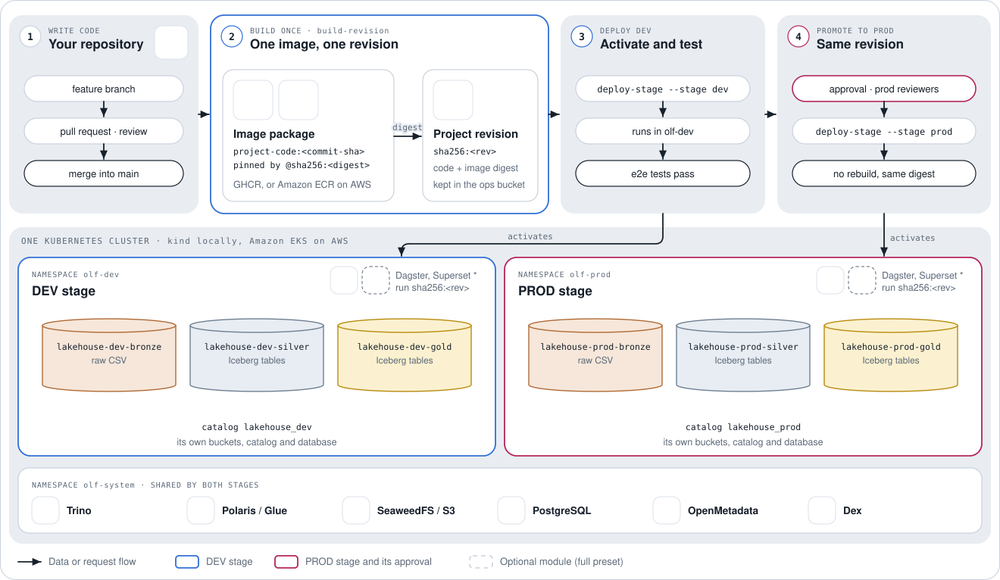

# Add PROD and promote a revision

This lesson adds a PROD stage to the project, builds the project once into an
immutable revision, activates that revision in DEV and then unchanged in PROD,
and shows the GitHub Actions that automate those steps.

**You will** run a project through DEV and PROD and see the PROD-only
schedule, in about 30 minutes.

**Start from** the project of [lesson 7](07-govern-and-trace-lineage.md): the
Full preset on a local deployment, with or without sign-in. You also need an account on a container registry such as GHCR or
Docker Hub.

## How stages work

A Deployment Profile can enable `dev`, an optional `uat` and `prod`. Every
stage runs in the same cluster, in its own `olf-<stage>` namespace with its own
Dagster (and Superset with the Full preset), its own buckets and its own
`lakehouse_<stage>` catalog. The platform services in `olf-system` are shared.

A change is built **once** into an immutable project revision: the project's
code plus one image pinned by digest. That revision is activated in DEV,
validated, and then activated unchanged in PROD. PROD never rebuilds, and no
data is copied between stages: each stage computes from its own Bronze.

<picture>
  <source media="(prefers-color-scheme: dark)" srcset="../assets/stage-promotion-dark.svg">
  
</picture>

## 1. Enable the PROD stage

Add `prod` under `spec.stages` in `openlakeforge.yaml`:

```yaml
spec:
  stages:
    dev:
      enabled: true
    prod:
      enabled: true
```

Then create the namespaces, buckets and catalogs for every enabled stage:

```bash
olf platform apply -f openlakeforge.yaml
```

## 2. Choose a registry

A revision is identified by an image digest, and an image built straight into
kind has none. Local runs therefore push to a registry you control:

```bash
export PROJECT_CODE_IMAGE_REPOSITORY=ghcr.io/<your-account>/project-code
export PROJECT_CODE_IMAGE_TAG=dev
docker login ghcr.io                     # or docker.io
```

## 3. Build the revision once

```bash
IMAGE="$(olf project image -f openlakeforge.yaml | tee /dev/stderr | tail -n 1)"
```

It builds the project-code image, pushes it and loads it into kind, showing its
progress, and ends with a digest-pinned reference,
`<repository>@sha256:<digest>`. `tail -n 1` keeps only that last line in
`IMAGE`. Build the revision from it the same way:

```bash
REVISION="$(olf project build --project . --image "$IMAGE" | tee /dev/stderr | tail -n 1)"
echo "$REVISION"
```

It prints the revision id, `sha256:<rev>`. The revision freezes your
descriptors, Floe contracts, dbt projects, Dagster code, reports and the image
digest.

## 4. Activate it in DEV, then in PROD

Activate it in DEV and validate it there first:

```bash
olf project deploy -f openlakeforge.yaml --stage dev --revision "$REVISION"
olf e2e run --env local -f openlakeforge.yaml --stage dev --suite full
```

Only when DEV passes, activate the same revision in PROD:

```bash
olf project deploy -f openlakeforge.yaml --stage prod --revision "$REVISION"
```

Activation reconciles the stage's catalog namespaces, activates its Floe
revision, imports its reports and metadata, and rolls out its Dagster code
location. It never rebuilds source.

## 5. Find the schedule

Open the PROD Dagster, listed under `URLs` by `olf status --provider local`,
and open the **Automation** or **Schedules** page. The schedule
`campaign_performance_daily` (`0 3 * * *`, UTC) exists in PROD only, and it is
stopped: deploying a revision never starts it. Switch it on there when you want
recurring runs. DEV has no schedules.

## 6. Automate with the CI actions

OpenLakeForge ships two composite GitHub Actions. Each is a few `olf`
commands, so any CI can run the same ones:

| Action | Does |
| --- | --- |
| `OpenLakeForge/openlakeforge/.github/actions/build-revision` | `olf project image`, then `olf project build`; outputs `image` and `revision` |
| `OpenLakeForge/openlakeforge/.github/actions/deploy-stage` | `olf project deploy --stage <s> --revision <r>`, fails unless `olf project status` records exactly `<r>`, and optionally runs `olf e2e run --suite full` |

Behaviour follows the stage and revision you pass, never the branch name. A
minimal `.github/workflows/promote.yml` for the local platform builds once,
deploys DEV, then PROD behind a GitHub environment with required reviewers:

```yaml
name: Promote

on:
  push:
    branches: [main]

concurrency:
  group: promote
  cancel-in-progress: false

env:
  OLF_VERSION: "0.4.0a1"

jobs:
  build:
    runs-on: [self-hosted, olf-platform]  # the machine that ran olf platform apply
    permissions:
      contents: read
      packages: write  # push the project-code image to GHCR
    outputs:
      revision: ${{ steps.build.outputs.revision }}
    steps:
      - uses: actions/checkout@34e114876b0b11c390a56381ad16ebd13914f8d5
      - run: python3.12 -m pip install "openlakeforge==${OLF_VERSION}" && olf toolchain install
      - run: echo "${{ secrets.GITHUB_TOKEN }}" | docker login ghcr.io -u "${{ github.actor }}" --password-stdin
      - id: build
        uses: OpenLakeForge/openlakeforge/.github/actions/build-revision@v0.4.0-alpha.1
        with:
          image-repository: ghcr.io/<your-account>/project-code

  dev:
    needs: build
    runs-on: [self-hosted, olf-platform]
    environment: dev
    permissions:
      contents: read
      packages: read  # activation pulls the revision's image
    steps:
      - uses: actions/checkout@34e114876b0b11c390a56381ad16ebd13914f8d5
      - run: python3.12 -m pip install "openlakeforge==${OLF_VERSION}" && olf toolchain install
      - run: echo "${{ secrets.GITHUB_TOKEN }}" | docker login ghcr.io -u "${{ github.actor }}" --password-stdin
      - uses: OpenLakeForge/openlakeforge/.github/actions/deploy-stage@v0.4.0-alpha.1
        with:
          stage: dev
          revision: ${{ needs.build.outputs.revision }}
          e2e-env: local

  prod:
    needs: [build, dev]
    runs-on: [self-hosted, olf-platform]
    environment: prod
    permissions:
      contents: read
      packages: read  # activation pulls the revision's image
    steps:
      - uses: actions/checkout@34e114876b0b11c390a56381ad16ebd13914f8d5
      - run: python3.12 -m pip install "openlakeforge==${OLF_VERSION}" && olf toolchain install
      - run: echo "${{ secrets.GITHUB_TOKEN }}" | docker login ghcr.io -u "${{ github.actor }}" --password-stdin
      - uses: OpenLakeForge/openlakeforge/.github/actions/deploy-stage@v0.4.0-alpha.1
        with:
          stage: prod
          revision: ${{ needs.build.outputs.revision }}
```

> [!WARNING]
> Create the `prod` GitHub environment with required reviewers before the
> first run. A workflow that names an environment GitHub has not seen creates
> it without protection and would promote to PROD without waiting.

The self-hosted runner holds the platform's `OLF_HOME` (its Terraform state
and kubeconfig). Cloud runs additionally need cloud credentials and registry
access; see [CI/CD and environment promotion](../guides/promote-dev-to-prod.md).

## Check it worked

```bash
olf e2e run --env local -f openlakeforge.yaml --stage prod --suite full
```

It validates PROD with the topology the profile recorded: it launches every
product's job in the PROD Dagster and requires rows in every Gold mart of the
`lakehouse_prod` catalog. It ends with:

```text
Local OpenLakeForge full e2e validation passed.
```

## What you learned

- Stages share a cluster but not data: each has its own namespace, buckets
  and catalog.
- You build one revision and activate that same revision in every stage.
- Schedules exist only in PROD, and start stopped.
- The two CI actions are thin wrappers over `olf project image`, `build` and
  `deploy`.

## Next

[Deploy to the cloud](10-deploy-to-the-cloud.md): run the same project on AWS.
